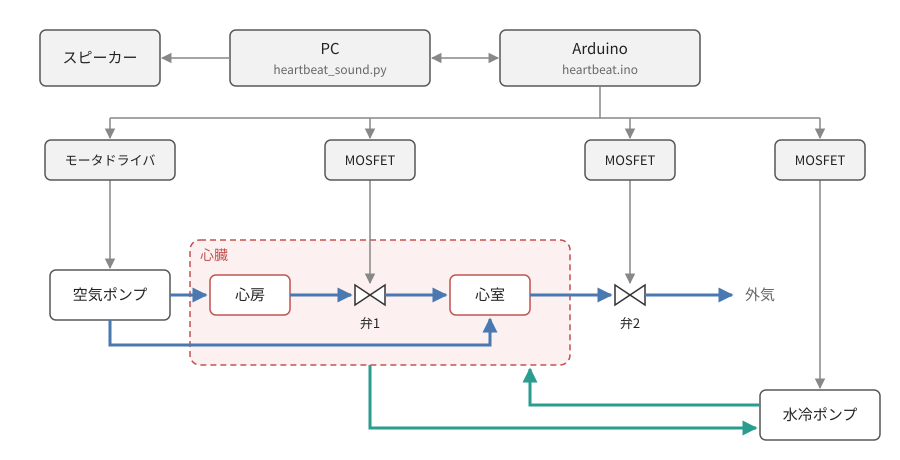

# Dynamic Heartbeat @東京大学制作展2026 Main

https://github.com/user-attachments/assets/2dedd3f1-b101-468e-ab6f-55a00ca67ba1

## Members

学際情報学専攻 椿　道智（Michitoshi TSUBAKI） 岡田研（JSK）
学際情報学専攻 杉本隆平（Ryuhei SUGIMOTO）

## Key Visual


## Setup

```bash
git clone https://github.com/Michi-Tsubaki/dynamic_heartbeat.git
cd dynamic_heartbeat
uv sync
```

## Usage

Arduino（UNO）へ書き込み（[arduino-cli](https://arduino.github.io/arduino-cli/) の場合．）

```bash
arduino-cli compile --fqbn arduino:avr:uno src/heartbeat
arduino-cli upload  --fqbn arduino:avr:uno -p /dev/ttyUSB0 src/heartbeat
```

拍動に同期して心音を鳴らす（起動後，数値で BPM 変更，`s` 停止，`g` 再開，`q` 終了）

```bash
uv run scripts/heartbeat_sound.py 60
```

配線確認は `src/actuator_test` を同様に書き込むと，各アクチュエータが順に ON/OFF する．

## System



## CAD

`parts/sldprt/*.SLDPRT` を SolidWorks で開く（3D プリント用 STL は `parts/stl/`）．
